# Manual de uso · Módulo de citas (EP3)

Responsable: Simon. Capturas tomadas el 12-11-2026 con la app en Docker y en modo API (`VITE_API_MODE=api`). Todo lo que se ve viene de ms-citas y de MySQL, no del `localStorage` de EP2.

## 1. Antes de empezar

1. Levantar todo: `docker compose up -d --build` en la raíz del proyecto (solo se necesita Docker).
2. Abrir **http://localhost:8080**.
3. Entrar con una de las cuentas de prueba:

| Rol           | Correo                   | Clave            | Qué ve                          |
| ------------- | ------------------------ | ---------------- | ------------------------------- |
| Paciente      | `javiera.soto@correo.cl` | `Paciente2026!`  | Solicitar cita, pago, Mis citas |
| Secretaria    | `recepcion@nutrivida.cl` | `Recepcion2026!` | Agenda de la clínica            |
| Nutricionista | `cfuentes@nutrivida.cl`  | `Nutri2026!`     | Mi agenda                       |
| Administrador | `admin@nutrivida.cl`     | `Admin2026!`     | Citas, detalle y comprobante    |

Tarjetas del pago simulado: **4242 4242 4242 4242** se aprueba y **4000 0000 0000 0002** se rechaza. Sirve cualquier vencimiento futuro (por ejemplo 12/30) y cualquier CVV de 3 dígitos.

> Mientras el login de ms-usuarios (G-32) no esté listo, el token lo entrega el perfil `dev` de ms-citas sin que el usuario lo note (plan B). Para el video y la entrega se apaga con `MS_CITAS_PERFILES=mysql` en `.env`.

## 2. Paciente

### 2.1 Solicitar una cita

Menú **Solicitar cita**. Son 4 pasos: servicio, nutricionista, fecha y hora, y motivo con resumen. En el paso 3 las horas tachadas no se pueden elegir porque ya pasaron, están tomadas o el servicio no cabe completo. La lista llega de `GET /api/disponibilidad`, la misma regla que usa ms-citas al aceptar la reserva.

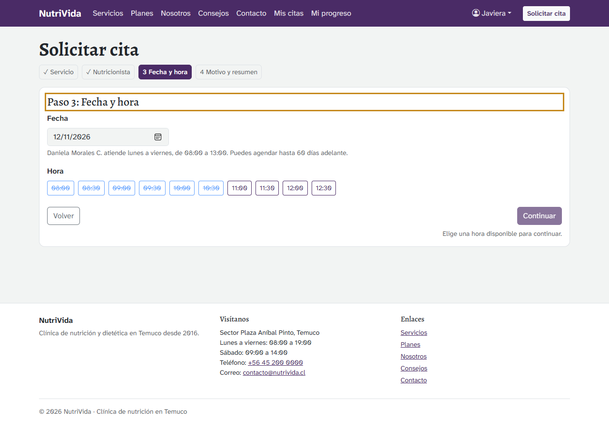

### 2.2 Pagar

El botón **Ir al pago** lleva al formulario de la tarjeta. Al pagar se hace **una sola petición**, `POST /api/citas`: ms-citas valida la tarjeta, revisa que la hora siga libre, cobra y crea la cita en una transacción.

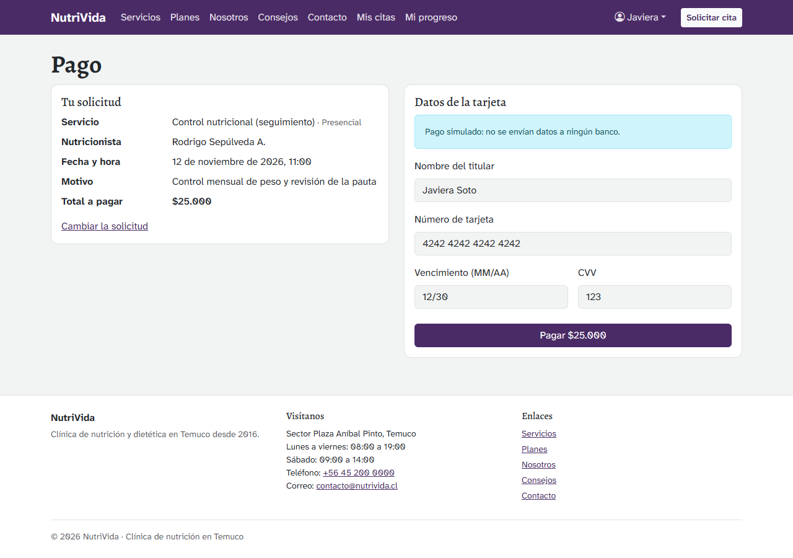

- **Aprobado:** se llega a "Solicitud enviada" con el número de cita y de pago. La cita queda **Pendiente** hasta que la clínica la confirme.
- **Rechazado** (tarjeta 4000…0002): pantalla de error con el motivo del banco. La reserva se conserva para intentar con otra tarjeta.
- **Hora tomada por otro paciente en ese instante:** aviso arriba del formulario, y no se cobra nada.

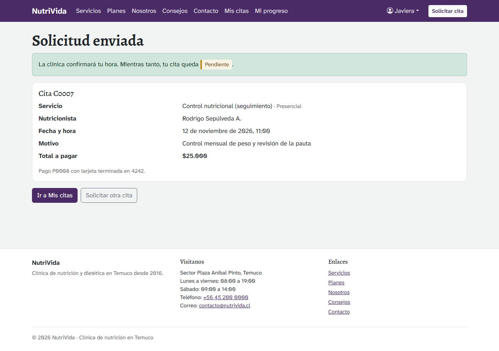

### 2.3 Mis citas

Pestañas **Próximas** e **Historial**. Las próximas se pueden cancelar o reprogramar con más de 24 h de anticipación. Al cancelar, el pago queda reembolsado. Con menos de 24 h, la página pide llamar a la clínica, y ms-citas responde 409 aunque alguien lo intente desde Swagger.

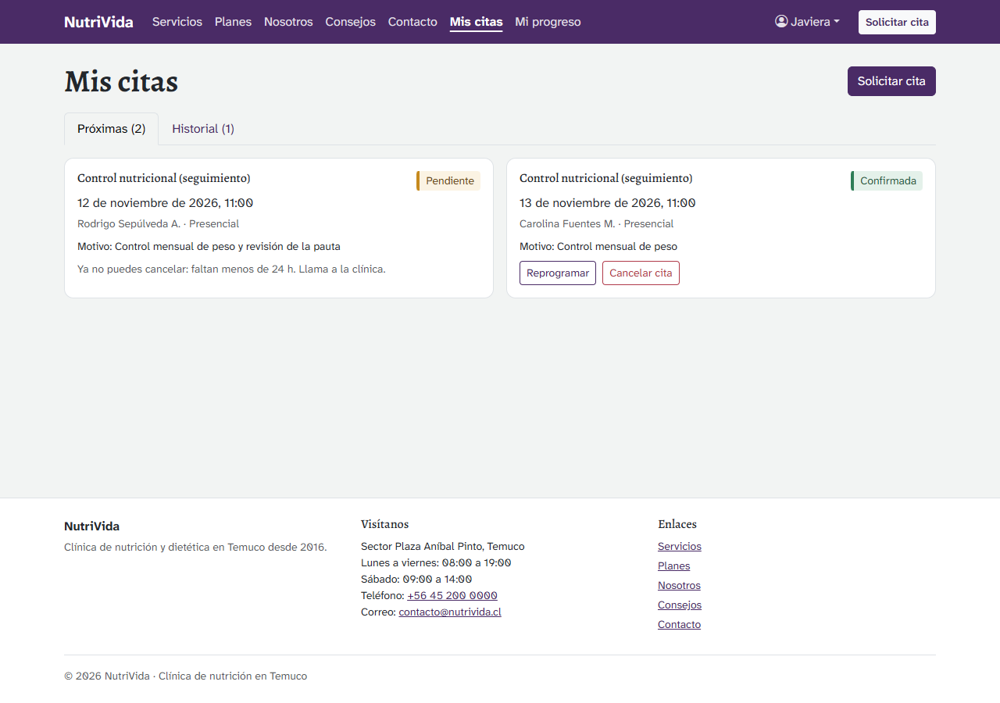

En el teléfono la misma vista pasa a una columna:

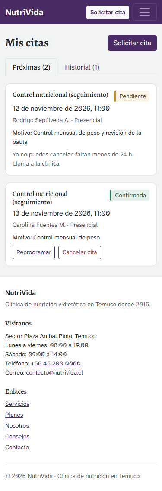

## 3. Secretaria: agenda de la clínica

Grilla del día con los 4 nutricionistas. "—" es fuera de la jornada. Al tocar una cita se abre el panel con sus datos, su historial y las acciones que permite su estado: confirmar, cancelar, marcar inasistencia y reprogramar (sin el límite de 24 h). En la captura aparece la cita que Javiera pagó en el punto 2.2.

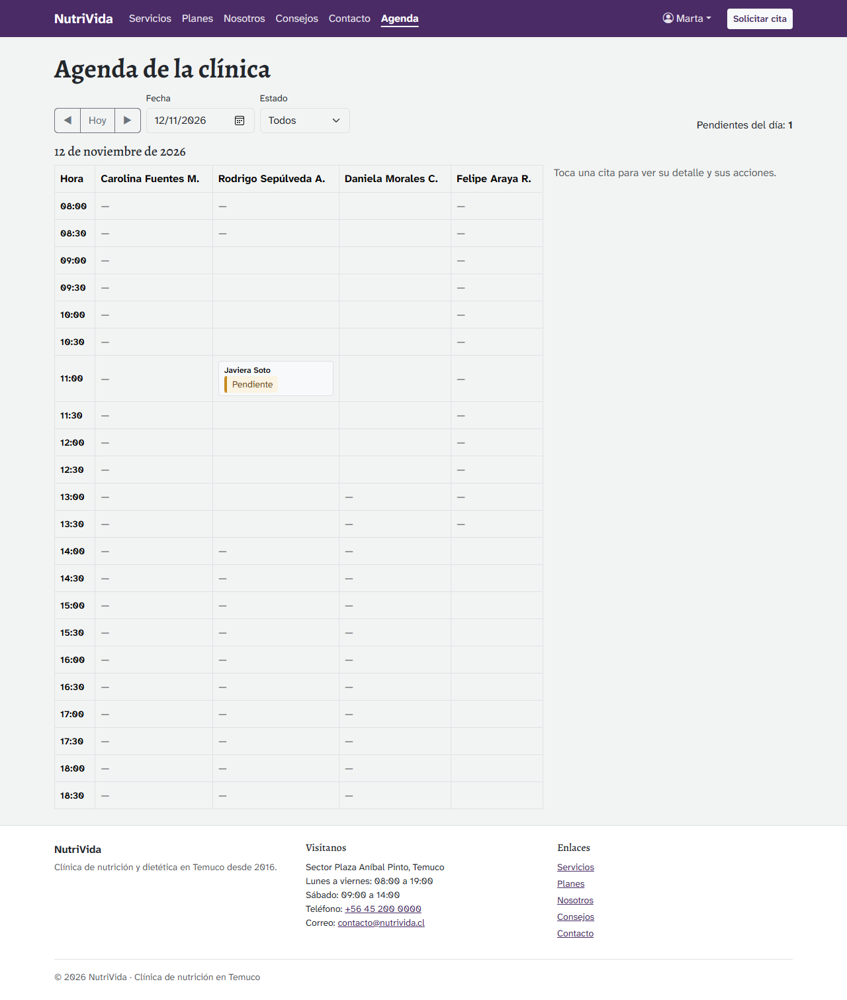

## 4. Nutricionista: mi agenda

Solo sus citas, en vista Día o Semana (`GET /api/citas/agenda`). Una cita confirmada se marca como atendida o inasistencia, y **Abrir ficha** lleva a la ficha del paciente (módulo clínico).

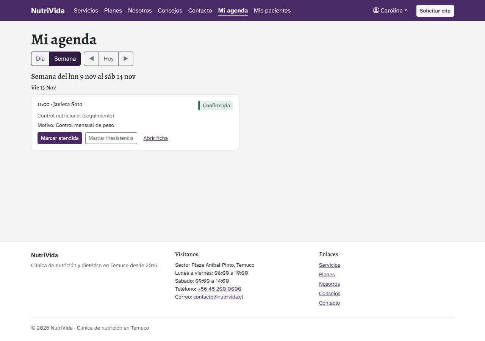

## 5. Administrador: citas y comprobantes

**Citas**, en el panel de administración: todas las citas con filtros por estado, nutricionista y fechas, y el total recaudado, que solo suma pagos aprobados.

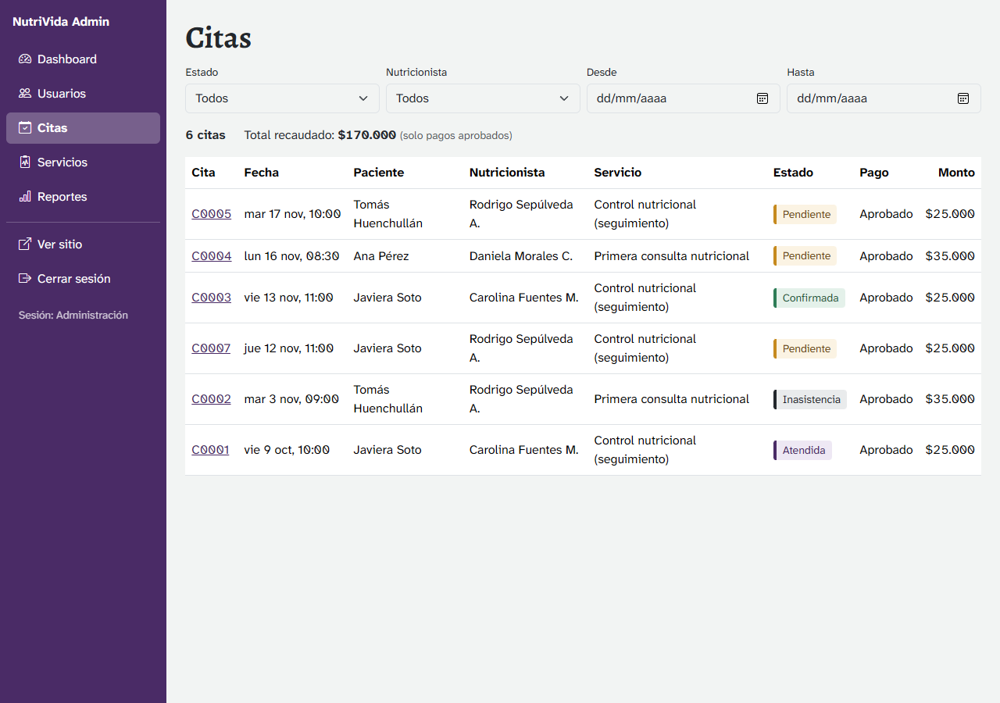

El detalle muestra la cita, su historial y el comprobante del pago con los 4 últimos dígitos de la tarjeta (`GET /api/pagos/{id}`).

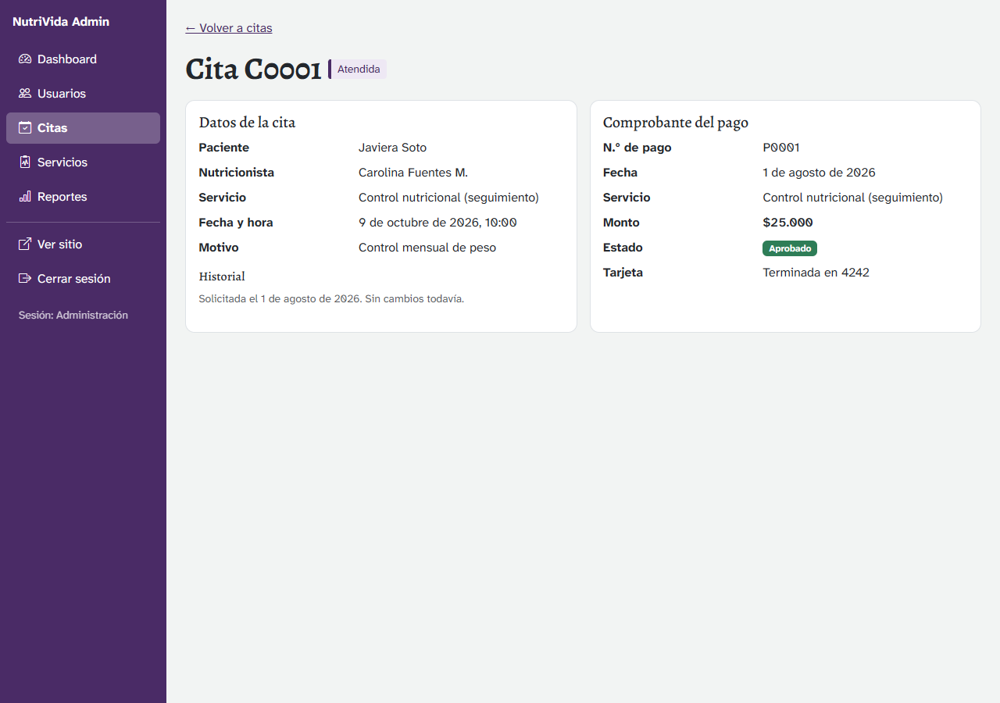

## 6. La API directamente

### 6.1 Swagger

**http://localhost:8082/swagger-ui.html**. Los 13 endpoints de ms-citas, con ejemplos y códigos de respuesta. Para probar los protegidos, se pide un token con `POST /api/dev/token` (solo con el perfil `dev`) y se pega en **Authorize**. `backend/ms-citas/peticiones.http` tiene el mismo recorrido para la extensión REST Client de VS Code.

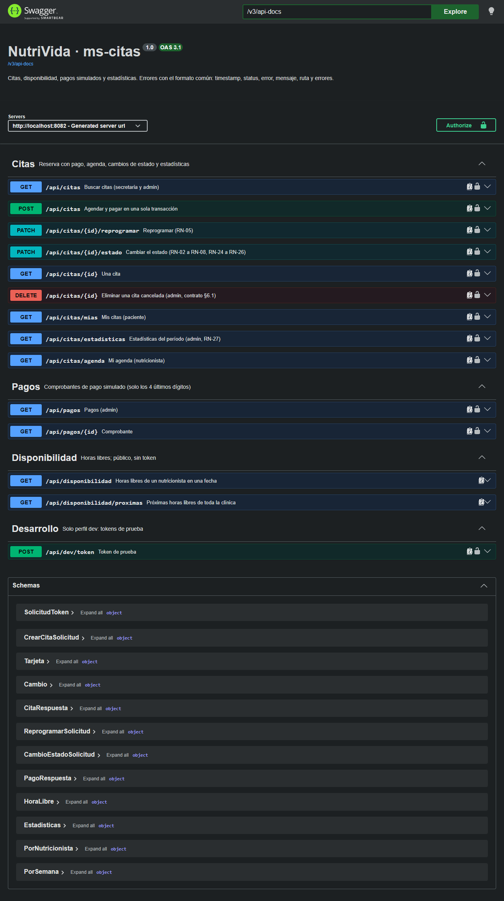

### 6.2 Formato de error común

Todo error responde con el mismo JSON: `timestamp`, `status`, `error`, `mensaje`, `ruta` y, si hay campos con error, `errores`. Por ejemplo, la API sin token:

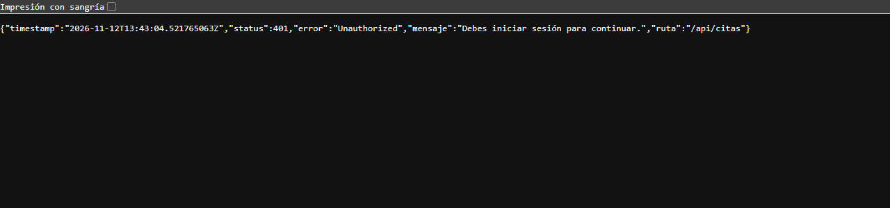

| Código | Cuándo en ms-citas                                                                 |
| ------ | ---------------------------------------------------------------------------------- |
| 400    | Datos inválidos: motivo corto, fecha fuera de los 60 días, tarjeta mal escrita     |
| 401    | Sin token, token vencido o inválido, o cuenta desactivada                          |
| 402    | El banco simulado rechazó la tarjeta                                               |
| 403    | El rol no puede hacer eso, o la cita no es suya                                    |
| 404    | La cita, el pago o la ruta no existen                                              |
| 409    | Hora tomada, cambio de estado no permitido, menos de 24 h o eliminar una no cancelada |
| 503    | ms-clinica o ms-usuarios no responden                                              |
